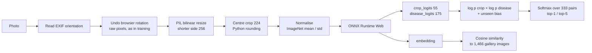

# Plant Disease Identifier: Web UI Guide

This guide covers the static web page in `UserInterface/web/`: what each part of the interface does, how a prediction is computed, and how the PyTorch models are compiled to ONNX so they can run in the browser.

---

## 1. Overview

The page identifies the **crop** and the **disease** in a leaf photo and ranks all **333 crop-disease combinations** of DPD-Small (55 crops, 175 diseases; 323 seen in training, 10 unseen). It can also rank the unseen combinations, so it does compositional zero-shot prediction.

- **No server.** The page is plain HTML, CSS and JavaScript. The models run in the browser with [ONNX Runtime Web](https://onnxruntime.ai/docs/get-started/with-javascript/web.html) (WebAssembly), so the photo never leaves the device.
- **Static hosting.** The folder deploys as it is to a Hugging Face static Space (`sdk: static` in `web/README.md`) or any static file host.
- **Deployed models.** The custom approach and two EfficientNet-B0 baselines:

| Picker label | Model | ONNX file | Size |
|---|---|---|---|
| Custom approach · S3 All (loaded by default) | frozen BioCLIP ViT-B/16 + learnt prompts, crop / disease adapters, crop-invariance GRL (`outputs/stage3e/best.pt`) | `model/s3_all.onnx` | 331 MB |
| Baseline 1 · Independent CNNs (EfficientNet-B0) | separate crop network + disease network | `model/effb0_independent.onnx` | 32 MB |
| Baseline 2 · Multi-task CNN (EfficientNet-B0) | one backbone, crop head + disease head | `model/effb0_multitask.onnx` | 17 MB |

### Running it locally

Browsers block `fetch()` from `file://` pages, so serve the folder over HTTP:

```bash
cd UserInterface/web
python -m http.server 8000
# open http://localhost:8000
```

Add `?demo` to the URL (`http://localhost:8000/?demo`) to fill the results with **random** scores. Demo mode only checks the layout, and a banner says so.

---

## 2. Page layout

```text
├── Header
│   ├── Title, model picker, model status
│   └── [View benchmarks]  [Compare models]
├── Input bar  (shrinks once a result is shown)
│   ├── Drag & drop / click to upload  +  [Try a random unseen sample]
│   └── Sample test images  [All | Seen | Unseen (OOD)]
├── Analysis workspace  (appears once an image is chosen)
│   ├── Left: Query image inspector
│   │   ├── Zoom / pan viewer
│   │   └── Ground truth comparison (sample images only)
│   └── Right: Diagnosis
│       ├── Pipeline steps with timings
│       ├── Top-1 diagnosis (crop, disease, composed class, seen / unseen badge)
│       ├── Top-5 predictions
│       └── Closest training matches gallery
├── Model comparison panel  (Compare models toggle)
├── Test-set result tiles of the selected model
└── [About the model]
```

On screens narrower than 720 px everything stacks into one column. Between 720 and 1100 px the inspector column narrows to 320 px.

---

## 3. Features

### 3.1 Header

| Element | What it does |
|---|---|
| **Model picker** | Lists every model in `model/config.json` as `Role · Name`. Switching models loads the new model (if not yet cached) and re-runs it on the current image. |
| **Status pill** | Shows *Loading…* with a download progress bar, then *ready*, *No model deployed yet*, *Demo mode* or an error message. |
| **View benchmarks** | Opens the benchmarks dialog (§3.9). |
| **Compare models** | Toggles the side-by-side comparison panel (§3.8). Disabled when fewer than two models are deployed. |

### 3.2 Input bar

- **Upload.** Click the dashed box or press Enter / Space on it to open the file picker, or drag a photo onto it. While a file is dragged over it, the box glows emerald and scales up slightly. If the dropped file is not an image, a message says so.
- **Try a random unseen sample.** Picks one of the unseen-combination test samples (never the one already shown). It's useful for a live demo of zero-shot prediction.
- **Sample test images.** Eight test images: four from `test_seen.csv` and four from `test_unseen.csv`. Each has a *Seen* / *Unseen* badge, and hovering shows the crop and disease. Above them, the pills **All samples / Seen test set / Unseen test set (OOD)** filter the strip.
- The samples are **exact copies of the test files** (or, for files over 600 KB, downscaled copies that keep the original orientation). The model therefore sees the same input as in the offline evaluation.

Once a result is on screen the input bar shrinks (smaller drop zone, a single row of thumbnails) to make room for the workspace.

### 3.3 Query image inspector (left column)

- **Zoom and pan.** Use **+ / −**, the mouse wheel (zooms around the pointer), or double-click (toggles 2×). When zoomed in, drag to pan. Zoom goes from 100% to 800%, and **Reset** returns to the fitted view. The image is shown whole, without cropping, on a checkerboard background.
- **Ground truth comparison.** Shown for sample images only. It lists the actual label and its source file (`test_seen.csv` / `test_unseen.csv`), the top-1 prediction, a **✓ Match / ✗ Mismatch** verdict, and three checks: crop correct, disease correct, actual label in the top 5.
- **Upload new image / Clear.** Both buttons stay next to the image.

### 3.4 Pipeline steps

While an image is analysed, three steps tick through with a spinner, and each one then shows how long it actually took:

1. **Extracting visual features:** preprocessing plus the ONNX forward pass.
2. **Combining crop & disease scores over 333 pairs:** composition scoring (§4.2).
3. **Retrieving closest seen training samples:** similarity against the gallery embeddings.

After that the list collapses into a one-line summary. The times are measured, not simulated; on a laptop CPU a full pass takes about 90 ms (multi-task) or 160 ms (independent).

### 3.5 Top-1 diagnosis

- **Combination name.** The predicted crop-disease combination, e.g. *Apple · Alternaria blotch*.
- **Seen / unseen badge:**
  - **In-distribution (seen)** (emerald): the combination appears in the training set.
  - **Out-of-distribution (unseen, zero-shot)** (amber): the combination never appears in training. The model predicts it by combining its separate crop and disease knowledge.
- **Pills.** **Crop type**, **Disease type** and **Composed class**, each colour-coded.
- **Confidence.** The probability of the top combination, a bar, and a level: **High** (≥ 70%), **Medium** (≥ 40%) or **Low** (< 40%).
- **Heads line.** What each head predicts on its own, e.g. *Crop head on its own: Apple (91.7%) · Disease head on its own: Alternaria blotch (93.6%)*. It shows when the best combination differs from the two separate best guesses.

### 3.6 Top-5 predictions

A collapsible list of the five highest-scoring combinations, each with its rank, probability, bar and *Seen* / *Unseen* tag. Clicking a row makes the gallery (§3.7) show training images for that candidate instead of the top-1.

### 3.7 Closest training matches (seen set)

Training images related to the selected prediction, labelled with their DPD-Small `train.csv` class and source dataset (e.g. *train · CDDM*). There are four tabs:

| Tab | Shows | When |
|---|---|---|
| **Nearest overall** | The 12 training images most similar to the photo, of any class | only when the model exports an embedding |
| **Same class** | Training images of the exact predicted combination (*6 of 80* = 6 thumbnails shown out of 80 training images) | seen combinations only (unseen ones have no training images) |
| **Crop matches** | The same crop with other diseases or healthy: the leaf structure the crop head learnt | always |
| **Disease symptom matches** | The same disease on *other* crops: the symptom pattern the disease head learnt | always |

For an unseen prediction, the crop and disease tabs show the two halves of knowledge the model combined.

When the model exports an embedding (both baselines do), every tab is **ranked by cosine similarity** between the model's embedding of the photo and of each training image. Each card then carries an **"NN% similar"** badge. Without an embedding, each tab shows a fixed sample, one image per class, and the note says that no similarity ranking is applied.

### 3.8 Model comparison

When **Compare models** is on, a panel below the workspace runs a second model (chosen in *Compare with*) on the **same image**. For each model it shows its role, name, top-1, confidence, seen / unseen tag, Match / Mismatch (for samples) and top-5, with the true label marked ✓ if it appears in the list. A summary line says whether the models agree and, for samples, which one is correct. Each model loads once and stays in memory, and each result is computed once per image.

### 3.9 Model benchmarks dialog

Opened from **View benchmarks**. All numbers come from `data/benchmarks.json`, which is generated from the real evaluation files in `outputs/<run>/eval/` (§6.4). Listed runs: Baseline 1, Baseline 2 and the custom approach S3 All (the deployed models, marked *deployed*), and its component runs S3 R5 and S3 R5 + R6 as ablations.

1. **Results table.** Top-1 and top-5 accuracy on seen, unseen and the harmonic mean, plus the calibrated best HM with the seen and unseen accuracy at that point. ★ marks the best run in each column. The harmonic mean is `H = 2 · Acc_seen · Acc_unseen / (Acc_seen + Acc_unseen)`.
2. **Top-1 vs Top-5 composition accuracy.** One small bar chart each for Seen, Unseen and Harmonic mean. In each bar the solid part is the top-1 accuracy and the lighter extension is the top-5. Hovering or focusing a row shows the exact values.
3. **Confusion on test_seen.** For runs that saved per-image predictions, a 55 × 55 **crop confusion heatmap**: rows are the actual crop, columns the predicted crop, and the shade is the share of that row's images. Hover a cell for the counts. **Errors only** hides the diagonal so the mistakes stand out. Beside it is a table of the **most confused combinations** (count and rate).

### 3.10 Other parts

- **Result tiles.** Test-set results of the selected model at its deployed bias: seen top-1, unseen top-1, harmonic mean and AUSUC.
- **About the model.** Explains the task, how combinations are scored and how the gallery works, then describes the selected model: architecture, training recipe, calibration bias and embedding.
- **No model deployed.** While `config.json` lists no models, uploads and samples still work and the diagnosis card says *No model deployed yet*.
- **Theme.** The page follows the system light / dark setting. Dark mode uses charcoal surfaces with an emerald accent; seen is always emerald and unseen always amber. Numbers use tabular figures so columns align.

---

## 4. How a prediction is computed



### 4.1 Preprocessing: same pixels as training

The models were evaluated with torchvision's `Resize(256) → CenterCrop(224) → ToTensor → Normalize` on PIL images. Browsers resize images differently, and at first that changed the top-1 prediction on about 1 image in 10. `preprocess()` in `app.js` therefore reproduces the PIL pipeline exactly:

| Step | Detail |
|---|---|
| EXIF orientation | The page reads the JPEG's EXIF orientation tag itself and undoes the browser's automatic rotation, because the training code (PIL without `exif_transpose`) used the stored pixels. About 9% of seen images carry such a tag. The preview is still shown upright. |
| Resize | PIL's `BILINEAR` resampling: a triangle filter widened by the scale factor when shrinking (antialiasing), horizontal pass then vertical, each rounded to 8 bits. Shorter side → `int(224 / 0.875) = 256`, longer side `int(256 · long / short)`. |
| Centre crop | Offsets use Python's `round()`, which rounds halves to even, so the crop lands on the same pixel as torchvision. |
| Normalise | `(x / 255 − mean) / std` with ImageNet mean `[0.485, 0.456, 0.406]` and std `[0.229, 0.224, 0.225]`, in NCHW order. |
| Very large photos | Photos over 5000 px on a side are first shrunk by the canvas, to limit memory. |

### 4.2 Composition scoring

The crop and disease heads are combined over the 333 valid pairs, the same way the evaluation code does it:

```text
score(c, d) = log softmax(crop_logits)[c] + log softmax(disease_logits)[d] + bias · [ (c, d) is unseen ]
p(c, d)     = softmax over the 333 scores
```

Models are strongly biased toward seen combinations: without a bias, unseen pairs almost never rank first (about 4–9% unseen top-1). Each model therefore uses its **calibrated unseen bias** (`unseen_bias` in `config.json`), the value that maximises the seen / unseen harmonic mean in the evaluation's bias sweep. The bias is chosen on the test sets, the standard compositional zero-shot protocol, and the About dialog says so.

| Model | Unseen bias | Seen top-1 | Unseen top-1 | Harmonic mean | AUSUC |
|---|---|---|---|---|---|
| Baseline 1 · Independent | +6.60 | 57.1% | 65.3% | 60.9% | 48.2% |
| Baseline 2 · Multi-task | +6.58 | 58.2% | 62.6% | 60.3% | 46.7% |

---

## 5. How the models are compiled to ONNX

Script: `UserInterface/tools/export_effb0_onnx.py`

### 5.1 Source checkpoints

The architecture comes from the training code itself (`stage1/stage1a/model.py`: `timm` EfficientNet-B0 backbone + `Dropout → Linear` heads), so the exported graph is the trained model.

| Output file | Checkpoints | Training run |
|---|---|---|
| `effb0_multitask.onnx` | `outputs/stage1a/best.pt` | Stage 1 re-run, multi-task |
| `effb0_independent.onnx` | `outputs/stage1b_crop/best.pt` + `outputs/stage1b_disease/best.pt` | Stage 1 re-run, independent |

Training recipe for both: AdamW (backbone LR 2e-4, head LR 1e-3, weight decay 0.05), 2 warm-up epochs, label smoothing 0.1, dropout 0.3, drop-path 0.2, gradient clipping 1.0, mixed precision, up to 30 epochs with early stopping (patience 8), seed 42.

### 5.2 Wrapper modules

Each checkpoint is loaded in `eval()` mode (dropout and drop-path off) and wrapped in a module that returns three outputs:

| Output | Shape | Meaning |
|---|---|---|
| `crop_logits` | `[1, 55]` | crop head logits |
| `disease_logits` | `[1, 175]` | disease head logits |
| `embedding` | `[1, 1280]` multi-task / `[1, 2560]` independent | pooled backbone feature(s) for the gallery |

- **Multi-task:** `forward_features` → last feature map `F` `[1, 1280, 7, 7]` → global average pool → both heads.
- **Independent:** both networks run inside one graph. The crop network gives the crop logits and the disease network gives the disease logits. The embedding is the two pooled features, each L2-normalised, concatenated, so its cosine similarity is the average of the two networks' similarities.

### 5.3 Export settings

```python
torch.onnx.export(wrapper, torch.randn(1, 3, 224, 224), "effb0_multitask.onnx",
                  dynamo=False, opset_version=17,
                  input_names=["image"],
                  output_names=["crop_logits", "disease_logits", "embedding"])
```

- **Input:** `image`, float32 `[1, 3, 224, 224]`, already normalised.
- **Opset 17**, TorchScript-based exporter (`dynamo=False`), fp32 weights.
- In the browser, ONNX Runtime Web 1.20.1 is loaded from jsDelivr only when a model is configured, and runs on the WebAssembly backend. Each model gets a warm-up run with a blank input on load.

### 5.4 Gallery embeddings

Script: `UserInterface/tools/export_gallery_embeddings.py`

This script embeds each of the 1,466 gallery thumbnails with the ONNX model. It uses the **full-size original** from `dataset/DPD_Small_dataset/`, matched by file name without the extension, and the same torchvision transform. Each row is L2-normalised and stored as raw little-endian **float16**. Row order is the page's gallery order: compositions by id, then each composition's `thumbs` list.

| File | Rows × dims | Size |
|---|---|---|
| `model/effb0_independent_gallery.f16` | 1466 × 2560 | 7.2 MB |
| `model/effb0_multitask_gallery.f16` | 1466 × 1280 | 3.6 MB |

float16 halves the download, and after normalisation it loses nothing that matters for cosine similarity. The page decodes it in JavaScript.

### 5.5 `config.json` entries

Each model is one entry in `web/model/config.json`:

| Field | Value for the baselines | Purpose |
|---|---|---|
| `id`, `name`, `short_name`, `role` | e.g. `effb0_multitask`, `Baseline 2` | picker label, comparison headings |
| `benchmark_id` | `stage1a` / `stage1b` | marks the row as *deployed* in the benchmarks dialog |
| `file` | `model/effb0_multitask.onnx` | ONNX file |
| `input_size`, `resize`, `crop_pct` | `224`, `center_crop`, `0.875` | preprocessing (§4.1) |
| `mean`, `std` | ImageNet | normalisation |
| `outputs` | `crop`, `disease`, `embedding` names | which ONNX outputs to read |
| `gallery_embeddings`, `gallery_dtype` | `model/…_gallery.f16`, `float16` | similarity ranking |
| `unseen_bias` | calibrated best bias | §4.2 |
| `metrics`, `about` | result tiles, About paragraphs | §3.10 |

The first model in the list loads by default. `embedding` is optional: a model without it still predicts, and the page shows an unranked gallery.

---

## 6. Verification

| Check | Result |
|---|---|
| ONNX Runtime vs PyTorch, same input, 40 test images per model | max \|difference\| ≤ 7e-5 on all outputs; same top-1 crop and disease on 40 / 40 |
| Browser preprocessing vs torchvision, 120 test images | mean difference 0.002 pixel levels, max 1 level (rounding) |
| Browser vs PyTorch pipeline, 120 test images (60 seen, 60 unseen), at the deployed bias | same top-1 **120 / 120** and same top-5 set **120 / 120** for both models |
| Deployed ONNX + config on the full test sets (2000 seen, 1448 unseen) vs `metrics.json` | within 0.2 points. Independent: seen 57.1 / unseen 65.1 / HM 60.9 (reported 57.1 / 65.3 / 60.9). Multi-task: 58.2 / 62.7 / 60.3 (reported 58.2 / 62.6 / 60.3). |

### 6.1 Rebuilding everything

From the repo root (needs `torch`, `timm`, `onnx`, `onnxruntime`, `torchvision`, `pandas`, `Pillow`):

```bash
python UserInterface/tools/build_web_data.py                       # classes.json, thumbs/, examples/
python UserInterface/tools/export_effb0_onnx.py --check            # ONNX files + ONNX-vs-PyTorch check
python UserInterface/tools/export_gallery_embeddings.py effb0_independent
python UserInterface/tools/export_gallery_embeddings.py effb0_multitask
python UserInterface/tools/build_benchmarks.py                     # data/benchmarks.json
```

### 6.2 Deploying to Hugging Face

Upload the contents of `UserInterface/web/` to a static Space. Files over 10 MB (all three `.onnx` files) must go through Git LFS. `model/s3_all.onnx` is not in the GitHub repo (over its 100 MB limit), so upload it from a local export (`tools/export_s3_all_onnx.py`). `huggingface-cli upload` does this automatically. With plain git, track `*.onnx` and `*.f16` in `.gitattributes`.

### 6.3 Adding another model

1. Export it to ONNX with input `image` `[1, 3, S, S]` and outputs `crop_logits` / `disease_logits` (or one `composition` output `[1, 333]`). Optionally add `embedding`.
2. Add an entry to `config.json` with its own preprocessing (`resize`, `mean`, `std`; CLIP-family models use CLIP's mean / std) and calibrated `unseen_bias`.
3. Run `export_gallery_embeddings.py <id>` if it has an embedding.
4. Compare the browser's top-5 with PyTorch's on a few test images.

The Compare models toggle and the model picker pick up the new entry automatically.

### 6.4 File reference

| Path | Role |
|---|---|
| `web/index.html` | page structure, dialogs |
| `web/style.css` | theme tokens (light / dark), layout, components |
| `web/app.js` | loading, preprocessing, ONNX inference, scoring, rendering, benchmarks charts |
| `web/data/classes.json` | crop / disease names, 333 compositions, gallery thumbnail lists, sample images |
| `web/data/benchmarks.json` | benchmarks dialog data |
| `web/model/config.json` | deployed models |
| `web/model/*.onnx`, `*_gallery.f16` | models and gallery embeddings |
| `web/thumbs/`, `web/examples/` | gallery thumbnails, sample test images |
| `tools/build_web_data.py` | builds `classes.json`, thumbnails, samples |
| `tools/build_benchmarks.py` | builds `benchmarks.json` from `outputs/*/eval` |
| `tools/export_effb0_onnx.py` | compiles the EfficientNet-B0 baselines to ONNX |
| `tools/export_gallery_embeddings.py` | builds the gallery embedding files |

---

## 7. Limitations

- **The calibration bias is an oracle value.** It was chosen on the test sets, so the result tiles are best-case calibrated numbers.
- **The first visit downloads the models:** 331 MB for the custom approach (loaded by default), and 17 MB and 32 MB for the baselines when they are selected, plus their gallery embeddings. After that the browser cache serves them.
- **The gallery holds 6 thumbnails per seen class.** "Same class" therefore shows at most 6, even when the class has more training images.
